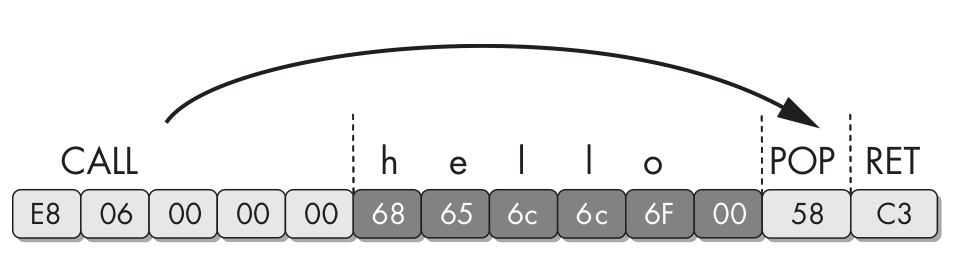
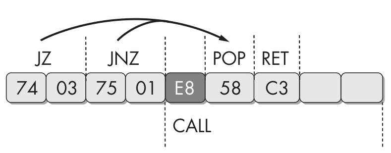
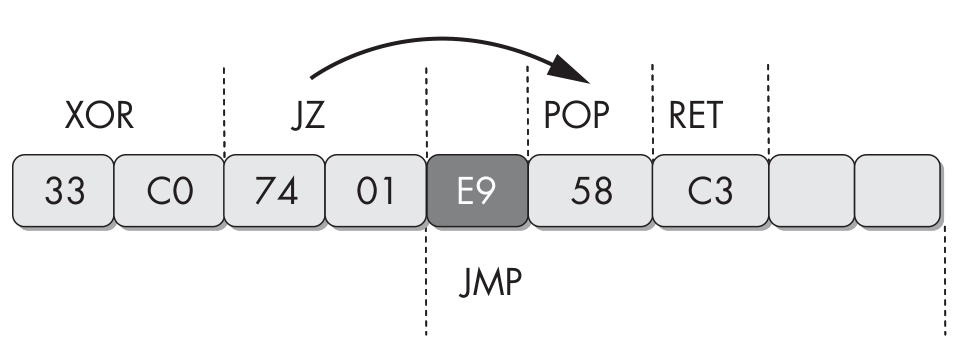
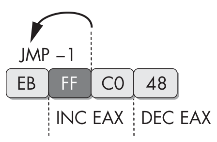
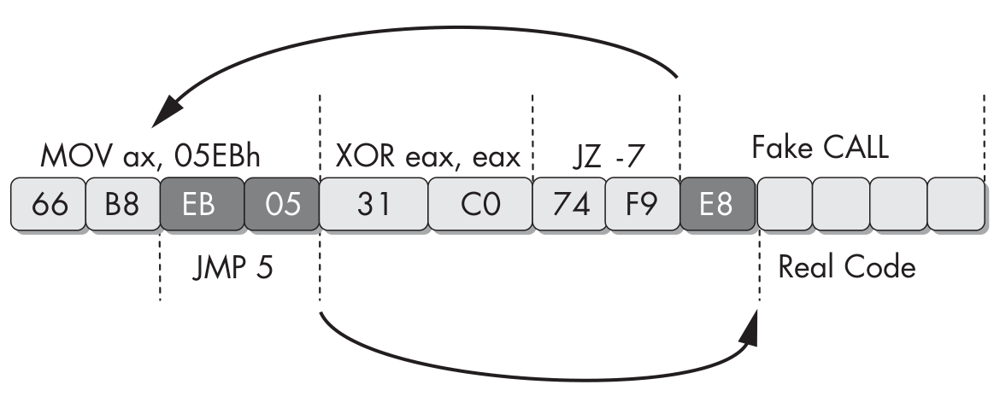
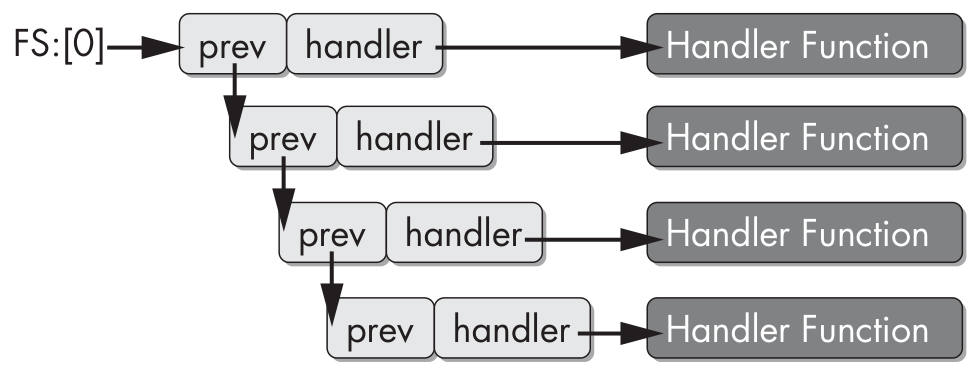

# Phần 5: Chống Dịch Ngược (Anti-Reverse-Engineering)

---

## Chương 15: Chống Disassembly (Anti-Disassembly)

Anti-disassembly (chống dịch ngược sang assembly) là việc sử dụng mã hoặc dữ liệu được chế tạo đặc biệt bên trong chương trình nhằm khiến các công cụ phân tích disassembly tạo ra một bản liệt kê chương trình (program listing) sai lệch. Kỹ thuật này được tác giả mã độc tạo ra thủ công, bằng một công cụ riêng trong quy trình build và triển khai, hoặc được đan xen trực tiếp vào mã nguồn của mã độc.

Mọi mã độc đều được thiết kế với một mục tiêu cụ thể: ghi lại thao tác bàn phím (keystroke logging), mở cửa sau (backdoor), dùng máy mục tiêu để gửi lượng email khổng lồ làm tê liệt máy chủ, v.v. Các tác giả mã độc thường đi xa hơn chức năng cơ bản này bằng cách triển khai những kỹ thuật riêng để ẩn mình khỏi người dùng hoặc quản trị viên hệ thống (dùng rootkit hoặc process injection), hoặc để cản trở việc phân tích và phát hiện.

Tác giả mã độc dùng anti-disassembly để trì hoãn hoặc ngăn chặn việc phân tích mã độc. Bất kỳ đoạn mã nào thực thi thành công thì đều có thể bị dịch ngược, nhưng bằng cách "bọc giáp" cho mã bằng anti-disassembly và anti-debugging, tác giả mã độc nâng cao trình độ kỹ năng mà nhà phân tích cần có. Quy trình điều tra vốn nhạy cảm về thời gian bị cản trở, khiến nhà phân tích không thể hiểu được khả năng của mã độc, không rút ra được các signature giá trị của máy chủ và mạng, cũng như không phát triển được các thuật toán giải mã. Những lớp bảo vệ bổ sung này có thể vượt quá trình độ của nhiều tổ chức và đòi hỏi chuyên gia tư vấn bên ngoài hoặc một dự án nghiên cứu quy mô lớn để dịch ngược.

Ngoài việc trì hoãn hoặc ngăn cản phân tích bởi con người, anti-disassembly còn hiệu quả trong việc ngăn chặn một số kỹ thuật phân tích tự động. Nhiều thuật toán phát hiện độ tương đồng của mã độc và công cụ heuristic của phần mềm diệt virus sử dụng phân tích disassembly để nhận diện hoặc phân loại mã độc. Bất kỳ quy trình thủ công hay tự động nào sử dụng các lệnh riêng lẻ của chương trình đều dễ bị ảnh hưởng bởi các kỹ thuật chống phân tích được mô tả trong chương này.

### 15.1 Hiểu Về Anti-Disassembly (Understanding Anti-Disassembly)

Disassembly không phải là một bài toán đơn giản. Một chuỗi mã thực thi có thể có nhiều cách biểu diễn disassembly, trong đó có những cách không hợp lệ và che giấu chức năng thực sự của chương trình. Khi triển khai anti-disassembly, tác giả mã độc tạo ra một chuỗi byte đánh lừa disassembler hiển thị một danh sách lệnh khác với những lệnh sẽ thực sự được thực thi.

Các kỹ thuật anti-disassembly hoạt động bằng cách lợi dụng các giả định và hạn chế của disassembler. Ví dụ, disassembler tại một thời điểm chỉ có thể biểu diễn mỗi byte của chương trình như một phần của **một** lệnh. Nếu disassembler bị lừa dịch tại sai offset, một lệnh hợp lệ có thể bị giấu khỏi tầm nhìn. Hãy xem đoạn mã disassembly sau:

```asm
                jmp     short near ptr loc_2+1
; ---------------------------------------------------------------------------
loc_2:                                  ; CODE XREF: seg000:00000000j
                call    near ptr 15FF2A71h
                or      [ecx], dl
                inc     eax
; ---------------------------------------------------------------------------
                db    0
```

Đoạn mã này được dịch bằng kỹ thuật **linear disassembly** và kết quả không chính xác. Đọc đoạn mã này, ta bỏ lỡ phần thông tin mà tác giả đang cố giấu. Ta thấy một lệnh `call` có vẻ hợp lệ, nhưng đích của lệnh `call` này vô nghĩa. Lệnh đầu tiên là `jmp` có đích nhảy không hợp lệ vì nó rơi vào giữa lệnh kế tiếp.

Bây giờ hãy xem cùng chuỗi byte đó nhưng được dịch bằng một chiến lược khác:

```asm
                jmp     short loc_3
; ---------------------------------------------------------------------------
                db 0E8h
; ---------------------------------------------------------------------------
loc_3:                                  ; CODE XREF: seg000:00000000j
                push    2Ah
                call    Sleep
```

Đoạn mã này cho thấy một chuỗi mnemonic assembly hoàn toàn khác, và có vẻ nhiều thông tin hơn. Ở đây ta thấy lời gọi hàm API `Sleep`. Đích của lệnh `jmp` đầu tiên giờ đã được biểu diễn chính xác, và ta thấy nó nhảy đến lệnh `push` rồi `call Sleep`. Byte ở dòng thứ ba là `0xE8`, nhưng chương trình không thực thi byte này vì lệnh `jmp` đã nhảy qua nó.

Đoạn mã này được dịch bằng **flow-oriented disassembler** thay vì linear disassembler như trước. Trong trường hợp này, flow-oriented disassembler chính xác hơn vì logic của nó phản ánh sát chương trình thực tế hơn và không cố dịch những byte không nằm trong luồng thực thi. Chúng ta sẽ thảo luận chi tiết hơn về linear và flow-oriented disassembly ở phần tiếp theo.

Như vậy, disassembly không đơn giản như bạn có thể đã nghĩ. Hai ví dụ trên cho thấy hai tập lệnh hoàn toàn khác nhau cho cùng một tập byte. Điều này chứng minh anti-disassembly có thể khiến disassembler tạo ra một tập lệnh không chính xác cho một dải byte nhất định. Một số kỹ thuật anti-disassembly đủ tổng quát để hoạt động trên hầu hết disassembler, trong khi số khác nhắm vào các sản phẩm cụ thể.

### 15.2 Đánh Bại Các Thuật Toán Disassembly (Defeating Disassembly Algorithms)

Các kỹ thuật anti-disassembly sinh ra từ những điểm yếu cố hữu trong thuật toán của disassembler. Mọi disassembler đều phải đưa ra một số giả định để trình bày rõ ràng đoạn mã mà nó đang dịch. Khi các giả định này sai, tác giả mã độc có cơ hội đánh lừa nhà phân tích.

Có hai loại thuật toán disassembler: **linear** (tuyến tính) và **flow-oriented** (hướng theo luồng điều khiển). Linear disassembly dễ triển khai hơn, nhưng cũng dễ sai sót hơn.

#### a. Linear Disassembly

Chiến lược linear disassembly lặp qua một khối mã, dịch từng lệnh một cách tuần tự mà không rẽ hướng. Chiến lược cơ bản này được dùng trong các hướng dẫn viết disassembler và được các debugger sử dụng rộng rãi. Linear disassembly dùng kích thước của lệnh vừa dịch để xác định byte tiếp theo cần dịch, bất kể các lệnh điều khiển luồng (flow-control).

Đoạn mã sau sử dụng thư viện disassembly `libdisasm` (`http://sf.net/projects/bastard/files/libdisasm/`) để cài đặt một disassembler thô sơ chỉ trong vài dòng C bằng linear disassembly:

```c
char buffer[BUF_SIZE];
int position = 0;
while (position < BUF_SIZE) {
   x86_insn_t insn;
   int size = x86_disasm(buf, BUF_SIZE, 0, position, &insn);

   if (size != 0) {
      char disassembly_line[1024];
      x86_format_insn(&insn, disassembly_line, 1024, intel_syntax);
      printf("%s\n", disassembly_line);
      position += size;
   } else {
      /* invalid/unrecognized instruction */
      position++;
   }
}
x86_cleanup();
```

Trong ví dụ này, vùng đệm `buffer` chứa các lệnh cần dịch. Hàm `x86_disasm` điền vào một cấu trúc dữ liệu thông tin chi tiết của lệnh vừa dịch và trả về kích thước của lệnh. Vòng lặp tăng biến `position` thêm giá trị `size` nếu dịch được một lệnh hợp lệ; ngược lại, nó tăng thêm một byte.

Thuật toán này sẽ dịch hầu hết mã mà không gặp vấn đề, nhưng thỉnh thoảng vẫn gây lỗi ngay cả với các file nhị phân lành tính. Nhược điểm chính của phương pháp này là nó dịch **quá nhiều** mã. Thuật toán cứ mù quáng dịch cho đến hết vùng đệm, kể cả khi các lệnh điều khiển luồng khiến chỉ một phần nhỏ vùng đệm được thực thi.

Trong một file thực thi định dạng PE, mã thực thi thường nằm trong một section duy nhất. Có thể cho rằng ta chỉ cần áp dụng thuật toán linear disassembly cho section `.text` chứa mã, nhưng vấn đề là section mã của hầu hết các file nhị phân cũng chứa cả dữ liệu không phải lệnh.

Một trong những loại dữ liệu phổ biến nhất trong section mã là các giá trị con trỏ, dùng trong idiom switch dạng bảng (table-driven switch). Đoạn disassembly sau (từ một disassembler phi tuyến) cho thấy một hàm có các con trỏ switch nằm ngay sau mã của hàm.

```asm
          jmp     ds:off_401050[eax*4] ; switch jump
          ; switch cases omitted ...
          xor     eax, eax
          pop     esi
          retn
; ---------------------------------------------------------------------------
off_401050 dd offset loc_401020    ; DATA XREF: _main+19r
dd offset loc_401027    ; jump table for switch statement
dd offset loc_40102E
dd offset loc_401035
```

Lệnh cuối cùng của hàm là `retn`. Trong bộ nhớ, các byte nằm ngay sau lệnh `retn` là các giá trị con trỏ bắt đầu bằng `401020`, hiển thị dưới dạng chuỗi byte hex `20 10 40 00`. Bốn giá trị con trỏ này tạo thành 16 byte dữ liệu bên trong section `.text`. Chúng cũng tình cờ được dịch thành các lệnh hợp lệ. Đoạn disassembly sau sẽ được thuật toán linear disassembly tạo ra khi nó tiếp tục dịch vượt quá cuối hàm:

```asm
and [eax],dl
inc eax
add [edi],ah
adc [eax+0x0],al
adc cs:[eax+0x0],al
xor eax,0x4010
```

Nhiều lệnh trong đoạn này gồm nhiều byte. Cách chủ chốt để tác giả mã độc khai thác thuật toán linear disassembly là cài các byte dữ liệu tạo thành opcode của các lệnh nhiều byte. Ví dụ, lệnh `call` cục bộ chuẩn dài 5 byte, bắt đầu bằng opcode `0xE8`. Nếu 16 byte dữ liệu của bảng switch kết thúc bằng giá trị `0xE8`, disassembler sẽ gặp opcode của lệnh `call` và coi 4 byte kế tiếp là toán hạng của lệnh đó, thay vì là phần đầu của hàm tiếp theo.

Thuật toán linear disassembly là loại dễ bị đánh bại nhất vì chúng không thể phân biệt mã và dữ liệu.

#### b. Flow-Oriented Disassembly

Một loại thuật toán disassembly tiên tiến hơn là flow-oriented disassembler. Đây là phương pháp được hầu hết disassembler thương mại như IDA Pro sử dụng.

Điểm khác biệt chính giữa flow-oriented và linear disassembly là disassembler không mù quáng lặp qua một vùng đệm và cho rằng dữ liệu toàn là các lệnh xếp sát nhau gọn gàng. Thay vào đó, nó kiểm tra từng lệnh và xây dựng một danh sách các vị trí cần dịch.

Đoạn mã sau chỉ có thể được dịch đúng bằng flow-oriented disassembler.

```asm
                test    eax, eax
                jz      short loc_1A
                push    Failed_string
                call    printf
                jmp     short loc_1D
; ---------------------------------------------------------------------------
Failed_string:  db 'Failed',0
; ---------------------------------------------------------------------------
loc_1A:
                xor     eax, eax
loc_1D:
                retn
```

Ví dụ này bắt đầu bằng `test` và một lệnh nhảy có điều kiện. Khi flow-oriented disassembler gặp lệnh rẽ nhánh `jz`, nó ghi nhận rằng trong tương lai cần dịch vị trí `loc_1A`. Vì đây chỉ là rẽ nhánh có điều kiện, lệnh ngay sau đó cũng có khả năng được thực thi, nên disassembler cũng sẽ dịch nó.

Hai dòng `push` và `call` chịu trách nhiệm in chuỗi `Failed` ra màn hình. Tiếp theo là lệnh `jmp`. Flow-oriented disassembler thêm đích của lệnh này, `loc_1D`, vào danh sách các vị trí cần dịch sau. Vì `jmp` là nhảy không điều kiện, disassembler sẽ không tự động dịch lệnh nằm ngay sau nó trong bộ nhớ. Thay vào đó, nó quay lại kiểm tra danh sách các vị trí đã ghi nhận trước đó, chẳng hạn `loc_1A`, và bắt đầu dịch từ điểm đó.

Ngược lại, khi linear disassembler gặp lệnh `jmp`, nó vẫn mù quáng dịch các lệnh tuần tự trong bộ nhớ, bất chấp luồng logic của mã. Trong trường hợp này, chuỗi `Failed` sẽ bị dịch thành mã, vô tình che mất chuỗi ASCII và hai lệnh cuối của đoạn ví dụ. Đoạn sau là cùng đoạn mã được dịch bằng thuật toán linear disassembly.

```asm
                test    eax, eax
                jz      short near ptr loc_15+5
                push    Failed_string
                call    printf
                jmp     short loc_15+9
Failed_string:
                inc     esi
                popa
loc_15:
                imul    ebp, [ebp+64h], 0C3C03100h
```

Với linear disassembly, disassembler không có quyền lựa chọn lệnh nào cần dịch tại một thời điểm nhất định. Còn flow-oriented disassembler thì **phải đưa ra lựa chọn và giả định**. Dù các lựa chọn và giả định này có vẻ không cần thiết, nhưng các lệnh mã máy đơn giản bị phức tạp hóa bởi những yếu tố rắc rối như con trỏ (pointer), exception và rẽ nhánh có điều kiện (conditional branch).

Rẽ nhánh có điều kiện cho flow-oriented disassembler hai nơi để lựa chọn: nhánh **true** hoặc nhánh **false**. Với mã do compiler thông thường sinh ra, việc disassembler xử lý nhánh true hay false trước không tạo ra khác biệt về kết quả. Tuy nhiên, với mã assembly viết tay và mã anti-disassembly, hai nhánh thường có thể tạo ra hai kết quả disassembly khác nhau cho cùng một khối mã. Khi có xung đột, hầu hết disassembler sẽ **tin vào cách diễn giải đầu tiên** của chúng tại một vị trí. Đa số flow-oriented disassembler sẽ xử lý (và do đó tin tưởng) **nhánh false trước** đối với mọi lệnh nhảy có điều kiện.



*Hình 15.1: Lệnh `call` theo sau bởi một chuỗi.*

Hình 15.1 cho thấy một chuỗi byte và các lệnh mã máy tương ứng. Lưu ý chuỗi `hello` nằm giữa các lệnh. Khi chương trình thực thi, chuỗi này bị lệnh `call` nhảy qua, và 6 byte của nó (kể cả ký tự NULL kết thúc) không bao giờ được thực thi như lệnh.

Lệnh `call` là một nơi khác mà disassembler phải đưa ra quyết định. Vị trí được gọi được thêm vào danh sách dịch trong tương lai, cùng với vị trí ngay sau lệnh `call`. Giống như với lệnh nhảy có điều kiện, hầu hết disassembler sẽ dịch các byte ngay sau lệnh `call` trước, và vị trí được gọi sau. Trong assembly viết tay, lập trình viên thường dùng lệnh `call` để lấy con trỏ đến một mẩu dữ liệu cố định thay vì thực sự gọi một subroutine. Trong ví dụ này, lệnh `call` được dùng để tạo con trỏ tới chuỗi `hello` trên stack. Lệnh `pop` theo sau `call` sau đó lấy giá trị này khỏi đỉnh stack và đưa vào một thanh ghi (EAX trong trường hợp này).

Khi dịch file nhị phân này bằng IDA Pro, ta thấy nó tạo ra disassembly không như mong đợi:

```asm
E8 06 00 00 00       call    near ptr loc_4011CA+1
68 65 6C 6C 6F       push    6F6C6C65h
                     loc_4011CA:
00 58 C3             add     [eax-3Dh], bl
```

Hóa ra chữ cái đầu tiên của chuỗi `hello` là `h`, có giá trị hex là `0x68`. Đây cũng là opcode của lệnh `push DWORD` dài 5 byte. Ký tự NULL kết thúc chuỗi `hello` lại tình cờ là byte đầu tiên của một lệnh hợp lệ khác. Flow-oriented disassembler trong IDA Pro quyết định xử lý luồng dịch ngay sau lệnh `call` trước khi xử lý đích của `call`, và do đó tạo ra hai lệnh sai này. Nếu nó xử lý đích trước, nó vẫn sẽ tạo ra lệnh `push` đầu tiên, nhưng lệnh theo sau `push` sẽ xung đột với các lệnh thật mà nó đã dịch được từ đích của `call`.

Nếu IDA Pro tạo ra kết quả không chính xác, bạn có thể chuyển thủ công các byte từ dữ liệu thành lệnh hoặc từ lệnh thành dữ liệu bằng phím **C** hoặc **D**:

- Nhấn phím **C** để biến vị trí con trỏ thành mã (code).
- Nhấn phím **D** để biến vị trí con trỏ thành dữ liệu (data).

Đây là cùng hàm đó sau khi đã dọn dẹp thủ công:

```asm
E8 06 00 00 00                       call    loc_4011CB
68 65 6C 6C 6F 00    aHello          db 'hello',0
                                     loc_4011CB:
58                                   pop     eax
C3                                   retn
```

### 15.3 Các Kỹ Thuật Anti-Disassembly (Anti-Disassembly Techniques)

Cách chủ đạo để mã độc ép disassembler tạo ra disassembly không chính xác là lợi dụng các lựa chọn và giả định của disassembler. Các kỹ thuật chúng ta xem xét trong chương này khai thác những giả định cơ bản nhất của disassembler và thường được nhà phân tích mã độc sửa dễ dàng. Các kỹ thuật cao cấp hơn lợi dụng loại thông tin mà disassembler thường không có sẵn, cũng như tạo ra mã không thể dịch hoàn toàn bằng các bản liệt kê assembly thông thường.

#### a. Các Lệnh Nhảy Có Cùng Đích (Jump Instructions with the Same Target)

Kỹ thuật anti-disassembly phổ biến nhất trong thực tế là hai lệnh nhảy có điều kiện liên tiếp cùng trỏ đến một đích. Ví dụ, nếu `jz loc_512` theo sau bởi `jnz loc_512`, vị trí `loc_512` sẽ luôn được nhảy tới. Sự kết hợp `jz` với `jnz` thực chất là một lệnh `jmp` không điều kiện, nhưng disassembler không nhận ra điều đó vì nó chỉ dịch từng lệnh một. Khi gặp `jnz`, disassembler vẫn tiếp tục dịch nhánh false của lệnh này, dù trên thực tế nhánh đó sẽ không bao giờ được thực thi.

Đoạn mã sau cho thấy cách diễn giải đầu tiên của IDA Pro đối với một đoạn mã được bảo vệ bằng kỹ thuật này:

```asm
74 03                  jz      short near ptr loc_4011C4+1
75 01                  jnz     short near ptr loc_4011C4+1
loc_4011C4:                     ; CODE XREF: sub_4011C0
                                ; sub_4011C0+2j
E8 58 C3 90 90         call    near ptr 90D0D521h
```

Trong ví dụ này, lệnh nằm ngay sau hai lệnh nhảy có điều kiện có vẻ là một lệnh `call` bắt đầu bằng byte `0xE8`. Thực ra không phải vậy, vì cả hai lệnh nhảy có điều kiện đều trỏ đến vị trí **sau byte `0xE8` một byte**. Khi xem đoạn mã này trong IDA Pro, các cross-reference tại `loc_4011C4` sẽ hiển thị màu **đỏ** thay vì màu xanh dương tiêu chuẩn, vì các tham chiếu thực tế trỏ vào bên trong lệnh tại vị trí này thay vì đầu lệnh. Với nhà phân tích mã độc, đây là dấu hiệu đầu tiên cho thấy mẫu đang phân tích có thể sử dụng anti-disassembly.

Đây là disassembly của cùng đoạn mã đó, nhưng lần này đã được sửa bằng phím **D** để biến byte ngay sau lệnh `jnz` thành dữ liệu, và phím **C** để biến các byte tại `loc_4011C5` thành lệnh.

```asm
74 03                  jz      short near ptr loc_4011C5
75 01                  jnz     short near ptr loc_4011C5
; -------------------------------------------------------------------
E8                     db 0E8h
; -------------------------------------------------------------------
                       loc_4011C5:                     ; CODE XREF: sub_4011C0
                                                       ; sub_4011C0+2j
58                     pop     eax
C3                     retn
```

Cột bên trái trong các ví dụ này hiển thị các byte cấu thành lệnh. Việc hiển thị trường này là tùy chọn, nhưng rất quan trọng khi học về anti-disassembly. Để hiển thị (hoặc tắt) các byte này, chọn **Options → General**. Tùy chọn **Number of Opcode Bytes** cho phép bạn nhập số byte muốn hiển thị.



*Hình 15.2: Một lệnh `jz` theo sau bởi một lệnh `jnz`.*

Hình 15.2 minh họa chuỗi byte trong ví dụ này.

> **Vì sao phải dùng hai lệnh nhảy?** Nếu chỉ dùng một lệnh nhảy có điều kiện, việc nó nhảy đi đâu sẽ phụ thuộc vào điều kiện lúc chạy. Nếu nhánh còn lại rơi vào vùng chứa byte rác (rogue byte), chính chương trình cũng sẽ bị crash. Với một cặp `jz`/`jnz` liên tiếp cùng đích, một trong hai lệnh chắc chắn được thực hiện, nên chương trình luôn chạy đúng, trong khi disassembler vẫn bị lừa dịch nhánh false chứa byte rác.

#### b. Lệnh Nhảy Có Điều Kiện Hằng (A Jump Instruction with a Constant Condition)

Một kỹ thuật anti-disassembly khác cũng thường gặp trong thực tế gồm **một** lệnh nhảy có điều kiện đặt ở vị trí mà điều kiện luôn không đổi. Đoạn mã sau sử dụng kỹ thuật này:

```asm
33 C0                  xor     eax, eax
74 01                  jz      short near ptr loc_4011C4+1
loc_4011C4:                             ; CODE XREF: 004011C2j
                                        ; DATA XREF: .rdata:004020ACo
E9 58 C3 68 94         jmp     near ptr 94A8D521h
```

Hãy để ý đoạn mã này bắt đầu bằng lệnh `xor eax, eax`. Lệnh này đặt thanh ghi EAX về 0 và, như một tác dụng phụ, đặt cờ zero (ZF). Lệnh tiếp theo là lệnh nhảy có điều kiện sẽ nhảy nếu cờ zero được bật. Thực tế, đây hoàn toàn không phải điều kiện, vì ta có thể đảm bảo cờ zero luôn được bật tại điểm này trong chương trình.

Như đã thảo luận, disassembler sẽ xử lý nhánh false trước, nhánh này sẽ tạo ra mã xung đột với nhánh true, và vì xử lý nhánh false trước nên nó tin tưởng nhánh đó hơn. Như bạn đã biết, bạn có thể dùng phím **D** khi con trỏ đang ở một dòng mã để biến mã thành dữ liệu, và nhấn phím **C** để biến dữ liệu thành mã. Dùng hai phím tắt này, nhà phân tích có thể sửa đoạn mã trên và hiển thị luồng thực thi thật như sau:

```asm
33 C0                  xor     eax, eax
74 01                  jz      short near ptr loc_4011C5
; --------------------------------------------------------------------
E9                     db 0E9h
; --------------------------------------------------------------------
loc_4011C5:                             ; CODE XREF: 004011C2j
                                        ; DATA XREF: .rdata:004020ACo
58                     pop     eax
C3                     retn
```

Trong ví dụ này, byte `0xE9` được dùng chính xác như byte `0xE8` trong ví dụ trước. `E9` là opcode của lệnh `jmp` dài 5 byte, còn `E8` là opcode của lệnh `call` dài 5 byte. Trong cả hai trường hợp, bằng cách lừa disassembler dịch tại vị trí này, 4 byte theo sau opcode bị che khỏi tầm nhìn.



*Hình 15.3: Điều kiện giả: `xor` theo sau bởi một lệnh `jz`.*

Hình 15.3 minh họa ví dụ này bằng đồ họa.

#### c. Disassembly Bất Khả Thi (Impossible Disassembly)

Ở các phần trước, ta đã xem xét mã bị disassembler dịch sai ngay lần thử đầu, nhưng với một disassembler tương tác như IDA Pro, ta vẫn có thể làm việc với kết quả disassembly để có được kết quả chính xác. Tuy nhiên, trong một số điều kiện, không có bản liệt kê assembly truyền thống nào biểu diễn chính xác các lệnh được thực thi. Chúng ta dùng thuật ngữ **impossible disassembly** (disassembly bất khả thi) cho những điều kiện như vậy, nhưng thuật ngữ này không hoàn toàn chính xác. Bạn vẫn có thể dịch các kỹ thuật này, nhưng cần một cách biểu diễn mã khác biệt hoàn toàn so với những gì disassembler hiện nay cung cấp.

Các kỹ thuật anti-disassembly đơn giản mà ta đã thảo luận sử dụng một byte dữ liệu được đặt có chủ đích sau lệnh nhảy có điều kiện, với ý tưởng rằng việc dịch bắt đầu từ byte này sẽ ngăn lệnh thật phía sau được dịch vì byte được chèn vào là opcode của một lệnh nhiều byte. Ta gọi đây là **rogue byte** (byte rác) vì nó không phải là một phần của chương trình mà chỉ nằm trong mã để đánh lạc hướng disassembler. Trong tất cả các ví dụ này, rogue byte có thể bị bỏ qua.

Nhưng nếu rogue byte **không thể** bị bỏ qua thì sao? Nếu nó là một phần của một lệnh hợp lệ thực sự được thực thi lúc chạy thì sao? Ở đây ta gặp một tình huống hóc búa: một byte bất kỳ có thể là một phần của **nhiều lệnh** đều được thực thi. Không disassembler nào trên thị trường hiện nay biểu diễn một byte đơn lẻ là một phần của hai lệnh, trong khi bộ xử lý không có giới hạn như vậy.



*Hình 15.4: Lệnh `jmp` trỏ vào chính nó.*

Hình 15.4 minh họa một ví dụ. Lệnh đầu tiên trong chuỗi 4 byte này là lệnh `jmp` dài 2 byte. Đích nhảy là **byte thứ hai của chính nó**. Điều này không gây lỗi, vì byte `FF` là byte đầu tiên của lệnh 2 byte kế tiếp, `inc eax`.

Vấn đề khi cố biểu diễn chuỗi này bằng disassembly là: nếu ta chọn biểu diễn byte `FF` là một phần của lệnh `jmp`, thì nó sẽ không còn để hiển thị như phần đầu của lệnh `inc eax`. Byte `FF` là một phần của **cả hai** lệnh thực sự được thực thi, và các disassembler hiện đại không có cách nào biểu diễn điều đó. Chuỗi 4 byte này tăng EAX lên rồi giảm đi, thực chất là một chuỗi NOP phức tạp. Nó có thể được chèn vào hầu như bất cứ đâu trong chương trình để phá vỡ chuỗi disassembly hợp lệ. Để giải quyết, nhà phân tích có thể thay toàn bộ chuỗi này bằng các lệnh NOP bằng một script IDC hoặc IDAPython gọi hàm `PatchByte`. Một cách khác là đơn giản biến tất cả thành dữ liệu bằng phím **D** để disassembly tiếp tục như mong đợi sau 4 byte đó.

Để thấy mức độ phức tạp có thể đạt được với những chuỗi lệnh kiểu này, ta hãy xem một mẫu tiên tiến hơn. Hình 15.5 minh họa một ví dụ hoạt động trên cùng nguyên tắc với ví dụ trước, trong đó một số byte là một phần của nhiều lệnh.



*Hình 15.5: Chuỗi nhảy ngược vào trong nhiều tầng.*

Lệnh đầu tiên trong chuỗi này là lệnh `mov` dài 4 byte. Hai byte cuối được tô đậm vì chúng vừa là một phần của lệnh này, vừa là một lệnh độc lập sẽ được thực thi sau. Lệnh đầu tiên nạp dữ liệu vào thanh ghi AX. Lệnh thứ hai, `xor`, sẽ xóa thanh ghi này về 0 và bật cờ zero. Lệnh thứ ba là lệnh nhảy có điều kiện sẽ nhảy nếu cờ zero được bật, nhưng thực chất là nhảy không điều kiện, vì lệnh trước luôn bật cờ zero. Disassembler sẽ quyết định dịch lệnh ngay sau `jz`, bắt đầu bằng byte `0xE8`, opcode của lệnh `call` dài 5 byte. Lệnh bắt đầu bằng byte `E8` thực tế sẽ không bao giờ được thực thi.

Disassembler trong tình huống này không thể dịch đích của lệnh `jz` vì những byte này đã được biểu diễn chính xác như một phần của lệnh `mov`. Mã mà `jz` trỏ tới sẽ luôn được thực thi, vì cờ zero luôn được bật tại điểm này. Lệnh `jz` trỏ vào giữa lệnh `mov` 4 byte đầu tiên. Hai byte cuối của lệnh này là toán hạng sẽ được đưa vào thanh ghi. Khi được dịch hoặc thực thi riêng, chúng tạo thành một lệnh `jmp` nhảy tiến 5 byte tính từ cuối lệnh.

Khi xem lần đầu trong IDA Pro, chuỗi này sẽ trông như sau:

```asm
66 B8 EB 05            mov     ax, 5EBh
31 C0                  xor     eax, eax
74 F9                  jz      short near ptr sub_4011C0+1
                loc_4011C8:
E8 58 C3 90 90         call    near ptr 98A8D525h
```

> **Diễn giải theo luồng thực thi thật:** `jz -7` nhảy ngược vào byte `EB` (byte thứ ba của lệnh `mov`). Từ đó `EB 05` được thực thi như `jmp +5`, nhảy qua byte `E8` giả và 4 byte của nó, đến đoạn mã thật là `pop eax` / `retn`.

Vì không có cách nào dọn dẹp đoạn mã để biểu diễn mọi lệnh được thực thi, ta phải chọn các lệnh để giữ lại. Tác dụng phụ ròng của chuỗi anti-disassembly này là thanh ghi EAX được đặt về 0. Nếu bạn thao tác mã bằng phím **D** và **C** trong IDA Pro sao cho chỉ lệnh `xor` và các lệnh ẩn hiển thị, kết quả sẽ như sau:

```asm
66                   byte_4011C0     db 66h
B8                                   db 0B8h
EB                                   db 0EBh
05                                   db    5
; ------------------------------------------------------------
31 C0                                xor     eax, eax
; ------------------------------------------------------------
74                                   db 74h
F9                                   db 0F9h
E8                                   db 0E8h
; ------------------------------------------------------------
58                                   pop     eax
C3                                   retn
```

Đây là một giải pháp có thể chấp nhận được vì nó chỉ hiển thị các lệnh liên quan đến việc hiểu chương trình. Tuy nhiên, giải pháp này có thể cản trở các quy trình phân tích như vẽ đồ thị (graphing), vì khó biết chính xác lệnh `xor` hay chuỗi `pop` và `retn` được thực thi như thế nào. Một giải pháp hoàn chỉnh hơn là dùng hàm `PatchByte` của ngôn ngữ script IDC để sửa các byte còn lại sao cho chúng hiển thị như các lệnh NOP.

Ví dụ này có hai vùng byte chưa được dịch cần chuyển thành lệnh NOP: 4 byte bắt đầu tại địa chỉ bộ nhớ `0x004011C0` và 3 byte bắt đầu tại địa chỉ `0x004011C6`. Script IDAPython sau sẽ chuyển các byte này thành byte NOP (`0x90`):

```python
def NopBytes(start, length):
   for i in range(0, length):
      PatchByte(start + i, 0x90)
   MakeCode(start)
NopBytes(0x004011C0, 4)
NopBytes(0x004011C6, 3)
```

Đoạn mã này theo cách làm "đường dài": tạo một hàm tiện ích `NopBytes` để NOP-out một dải byte, sau đó dùng hàm này cho hai dải cần sửa. Khi chạy script, disassembly thu được sạch sẽ, dễ đọc và tương đương logic với bản gốc:

```asm
90                       nop
90                       nop
90                       nop
90                       nop
31 C0                    xor     eax, eax
90                       nop
90                       nop
90                       nop
58                       pop     eax
C3                       retn
```

#### d. NOP-ing Out Instructions với IDA Pro (NOP-ing Out Instructions with IDA Pro)

Script IDAPython ở trên hoạt động rất tốt cho kịch bản này, nhưng tính hữu dụng bị hạn chế khi áp dụng cho các thách thức mới. Để dùng lại script, nhà phân tích mã độc phải tự quyết định các offset và độ dài byte cần đổi thành NOP, rồi chỉnh sửa script thủ công với các giá trị mới.

Với một chút kiến thức về IDA Python, ta có thể xây dựng một script cho phép nhà phân tích dễ dàng NOP-out các lệnh tùy ý. Script sau thiết lập phím tắt **ALT-N**. Sau khi chạy script này, mỗi khi người dùng nhấn ALT-N, IDA Pro sẽ NOP-out lệnh đang ở vị trí con trỏ. Nó cũng tiện lợi tự động đưa con trỏ đến lệnh kế tiếp để dễ dàng NOP-out các khối mã lớn.

```python
import idaapi
idaapi.CompileLine('static n_key() { RunPythonStatement("nopIt()"); }')
AddHotkey("Alt-N", "n_key")
def nopIt():

      start = ScreenEA()
      end = NextHead(start)
      for ea in range(start, end):
            PatchByte(ea, 0x90)
      Jump(end)
      Refresh()
```

### 15.4 Che Giấu Luồng Điều Khiển (Obscuring Flow Control)

Các disassembler hiện đại như IDA Pro làm rất tốt việc liên hệ các lời gọi hàm và suy ra thông tin cấp cao dựa trên hiểu biết về mối quan hệ giữa các hàm. Kiểu phân tích này hiệu quả với mã viết theo phong cách lập trình chuẩn bằng compiler chuẩn, nhưng dễ dàng bị tác giả mã độc đánh bại.

#### a. Vấn Đề Con Trỏ Hàm (The Function Pointer Problem)

Con trỏ hàm (function pointer) là một idiom lập trình phổ biến trong ngôn ngữ C và được dùng rộng rãi ngầm trong C++. Dù vậy, chúng vẫn gây khó khăn cho disassembler.

Dùng con trỏ hàm theo đúng cách trong một chương trình C có thể làm giảm đáng kể lượng thông tin có thể tự động suy ra về luồng chương trình. Nếu con trỏ hàm được dùng trong assembly viết tay hoặc được tạo theo cách không chuẩn trong mã nguồn, kết quả có thể rất khó dịch ngược nếu không có phân tích động.

Danh sách assembly sau cho thấy hai hàm. Hàm thứ hai sử dụng hàm thứ nhất thông qua một con trỏ hàm.

```asm
004011C0 sub_4011C0      proc near               ; DATA XREF: sub_4011D0+5o
004011C0
004011C0 arg_0           = dword ptr  8
004011C0
004011C0                 push    ebp
004011C1                 mov     ebp, esp
004011C3                 mov     eax, [ebp+arg_0]
004011C6                 shl     eax, 2
004011C9                 pop     ebp
004011CA                 retn
004011CA sub_4011C0      endp
004011D0 sub_4011D0      proc near               ; CODE XREF: _main+19p
004011D0                                         ; sub_401040+8Bp
004011D0
004011D0 var_4           = dword ptr -4
004011D0 arg_0           = dword ptr  8
004011D0
004011D0                 push    ebp
004011D1                 mov     ebp, esp
004011D3                 push    ecx
004011D4                 push    esi
004011D5                 mov   [ebp+var_4], offset sub_4011C0
004011DC                 push    2Ah
004011DE                 call  [ebp+var_4]
004011E1                 add     esp, 4
004011E4                 mov     esi, eax
004011E6                 mov     eax, [ebp+arg_0]
004011E9                 push    eax
004011EA                 call  [ebp+var_4]
004011ED                 add     esp, 4
004011F0                 lea     eax, [esi+eax+1]
004011F4                 pop     esi
004011F5                 mov     esp, ebp
004011F7                 pop     ebp
004011F8                 retn
004011F8 sub_4011D0      endp
```

Dù ví dụ này không đặc biệt khó dịch ngược, nó phơi bày một vấn đề then chốt. Hàm `sub_4011C0` thực ra được gọi từ **hai** vị trí khác nhau (tại `004011DE` và `004011EA`) bên trong hàm `sub_4011D0`, nhưng chỉ hiển thị **một** cross-reference (`DATA XREF: sub_4011D0+5o`). Lý do là IDA Pro phát hiện được tham chiếu ban đầu tới hàm khi offset của nó được nạp vào biến stack tại dòng `004011D5`. Điều IDA Pro không phát hiện được là hàm này sau đó được gọi hai lần từ `004011DE` và `004011EA`. Mọi thông tin về prototype của hàm mà bình thường được tự động lan truyền sang hàm gọi cũng bị mất.

Khi dùng rộng rãi và kết hợp với các kỹ thuật anti-disassembly khác, con trỏ hàm có thể làm tăng đáng kể độ phức tạp và khó khăn của việc dịch ngược.

> **Lưu ý:** Con trỏ hàm được lưu vào biến cục bộ nên nếu ta x-ref biến đó, ta chỉ thấy đúng hàm đang sử dụng nó, chứ không thấy các nơi thực sự gọi hàm đích.

#### b. Thêm Cross-Reference Mã Bị Thiếu Trong IDA Pro (Adding Missing Code Cross-References in IDA Pro)

Mọi thông tin không được tự động lan truyền ngược lên, như tên đối số của hàm, có thể được nhà phân tích thêm thủ công dưới dạng comment. Để thêm cross-reference thực sự, ta phải dùng ngôn ngữ IDC (hoặc IDAPython) để báo cho IDA Pro biết rằng hàm `sub_4011C0` thực ra được gọi từ hai vị trí trong hàm kia.

Hàm IDC ta dùng là `AddCodeXref`. Nó nhận ba đối số: vị trí nguồn của tham chiếu, vị trí đích của tham chiếu, và một loại luồng (flow type). Hàm hỗ trợ nhiều loại flow khác nhau, nhưng với mục đích của ta, hữu ích nhất là `fl_CF` cho lệnh `call` thông thường hoặc `fl_JF` cho lệnh `jmp`. Để sửa đoạn assembly ví dụ trước trong IDA Pro, script sau đã được thực thi:

```c
AddCodeXref(0x004011DE, 0x004011C0, fl_CF);
AddCodeXref(0x004011EA, 0x004011C0, fl_CF);
```

#### c. Lạm Dụng Con Trỏ Trả Về (Return Pointer Abuse)

Lệnh `call` và `jmp` không phải là các lệnh duy nhất chuyển điều khiển trong chương trình. Đối ứng của lệnh `call` là `retn` (còn được viết là `ret`). Lệnh `call` hoạt động giống lệnh `jmp`, nhưng nó đẩy thêm một con trỏ trả về (return pointer) lên stack. Điểm trả về là địa chỉ bộ nhớ nằm ngay sau cuối lệnh `call`.

Vì `call` là sự kết hợp của `jmp` và `push`, nên `retn` là sự kết hợp của `pop` và `jmp`. Lệnh `retn` lấy giá trị ở đỉnh stack và nhảy tới đó. Thông thường nó được dùng để trả về từ một lời gọi hàm, nhưng không có lý do kiến trúc nào ngăn nó được dùng cho điều khiển luồng nói chung.

Khi `retn` được dùng theo cách khác ngoài việc trả về từ một hàm, ngay cả những disassembler thông minh nhất cũng có thể bị "mù". Kết quả rõ ràng nhất của kỹ thuật này là disassembler không hiển thị bất kỳ code cross-reference nào tới đích được nhảy tới. Một lợi ích chính khác của kỹ thuật này là disassembler sẽ kết thúc hàm sớm một cách sai lệch.

Hãy xem đoạn assembly sau:

```asm
004011C0 sub_4011C0      proc near               ; CODE XREF: _main+19p
004011C0                                         ; sub_401040+8Bp
004011C0
004011C0 var_4           = byte ptr -4
004011C0
004011C0                 call    $+5
004011C5                 add     [esp+4+var_4], 5
004011C9                 retn
004011C9 sub_4011C0      endp ; sp-analysis failed
004011C9
004011CA ; ------------------------------------------------------------
004011CA                 push    ebp
004011CB                 mov     ebp, esp
004011CD                 mov     eax, [ebp+8]
004011D0                 imul    eax, 2Ah
004011D3                 mov     esp, ebp
004011D5                 pop     ebp
004011D6                 retn
```

Đây là một hàm đơn giản nhận một số và trả về tích của số đó với 42. Đáng tiếc, IDA Pro không thể suy ra bất kỳ thông tin có ý nghĩa nào về hàm này vì nó đã bị đánh bại bởi một lệnh `retn` giả (rogue). Lưu ý rằng IDA Pro không phát hiện ra sự tồn tại của một đối số của hàm. Ba lệnh đầu tiên thực hiện việc nhảy đến phần bắt đầu thật của hàm. Hãy xem xét từng lệnh.

Lệnh đầu tiên trong hàm là `call $+5`. Lệnh này chỉ đơn giản gọi vị trí ngay sau chính nó, kết quả là một con trỏ tới vị trí bộ nhớ này được đặt lên stack. Trong ví dụ cụ thể này, giá trị `0x004011C5` sẽ nằm ở đỉnh stack sau khi lệnh thực thi. Đây là lệnh phổ biến trong mã cần tự tham chiếu (self-referential) hoặc độc lập vị trí (position-independent), và sẽ được đề cập chi tiết hơn ở Chương 19.

Lệnh tiếp theo là `add [esp+4+var_4], 5`. Nếu bạn quen đọc disassembly của IDA Pro, bạn có thể nghĩ lệnh này tham chiếu một biến stack `var_4`. Trong trường hợp này, phân tích stack frame của IDA Pro đã sai, và lệnh này không tham chiếu thứ có thể là biến stack thông thường, được tự động đặt tên `var_4` trong một hàm bình thường. Điều này thoạt đầu có vẻ khó hiểu, nhưng hãy chú ý rằng ở đầu hàm, `var_4` được định nghĩa là hằng số `-4`. Nghĩa là thứ bên trong ngoặc là `[esp+4+(-4)]`, cũng có thể biểu diễn là `[esp+0]` hay đơn giản là `[esp]`. Lệnh này cộng năm vào giá trị ở đỉnh stack, vốn là `0x004011C5`. Kết quả của phép cộng là giá trị ở đỉnh stack sẽ là `0x004011CA`.

Lệnh cuối trong chuỗi này là `retn`, có mục đích duy nhất là lấy giá trị này khỏi stack và nhảy tới đó. Nếu bạn xem mã tại vị trí `0x004011CA`, nó có vẻ là phần bắt đầu hợp lệ của một hàm khá bình thường. Hàm "thật" này bị IDA Pro xác định là không thuộc hàm nào do sự hiện diện của lệnh `retn` giả.

Để sửa ví dụ này, ta có thể patch ba lệnh đầu bằng các lệnh NOP và điều chỉnh ranh giới hàm để bao phủ hàm thật.

Để điều chỉnh ranh giới hàm, đặt con trỏ IDA Pro bên trong hàm muốn điều chỉnh và nhấn **ALT-P**. Chỉnh địa chỉ kết thúc hàm thành địa chỉ bộ nhớ ngay sau lệnh cuối cùng của hàm. Để thay vài lệnh đầu bằng `nop`, tham khảo kỹ thuật script đã mô tả trong mục "NOP-ing Out Instructions with IDA Pro" ở phía trên (mục 15.3.d).

#### d. Lạm Dụng Structured Exception Handler (Misusing Structured Exception Handlers)

Cơ chế Structured Exception Handling (SEH) cung cấp một phương thức điều khiển luồng mà disassembler không thể lần theo và sẽ đánh lừa cả debugger. SEH là một tính năng của kiến trúc x86, nhằm cung cấp cách để chương trình xử lý các điều kiện lỗi một cách thông minh. Các ngôn ngữ lập trình như C++ và Ada dựa nhiều vào xử lý exception và được chuyển đổi tự nhiên sang SEH khi biên dịch trên hệ thống x86.

Trước khi tìm hiểu cách tận dụng SEH để che giấu luồng điều khiển, hãy xem một vài khái niệm cơ bản về cách nó hoạt động. Exception có thể được kích hoạt vì nhiều lý do, chẳng hạn truy cập vùng bộ nhớ không hợp lệ hoặc chia cho 0. Các software exception bổ sung có thể được ném ra bằng cách gọi hàm `RaiseException`.

**SEH chain** là một danh sách các hàm được thiết kế để xử lý exception trong luồng (thread). Mỗi hàm trong danh sách có thể xử lý exception hoặc chuyển nó cho handler kế tiếp. Nếu exception đi đến tận handler cuối cùng, nó được coi là *unhandled exception* (exception không được xử lý). Handler cuối cùng là đoạn mã chịu trách nhiệm kích hoạt hộp thoại quen thuộc thông báo cho người dùng rằng "đã xảy ra một unhandled exception". Exception xảy ra thường xuyên ở hầu hết các tiến trình, nhưng được xử lý âm thầm trước khi chúng đến trạng thái cuối cùng là làm crash tiến trình và thông báo cho người dùng.

Để tìm SEH chain, hệ điều hành kiểm tra thanh ghi đoạn FS. Thanh ghi này chứa một segment selector dùng để truy cập Thread Environment Block (TEB). Cấu trúc đầu tiên trong TEB là Thread Information Block (TIB). Phần tử đầu tiên của TIB (và do đó là những byte đầu tiên của TEB) là một con trỏ tới SEH chain. SEH chain là một danh sách liên kết đơn giản gồm các cấu trúc dữ liệu 8 byte gọi là các bản ghi `EXCEPTION_REGISTRATION`.

```c
struct _EXCEPTION_REGISTRATION {
   DWORD prev;
   DWORD handler;
};
```

Phần tử đầu tiên của bản ghi `EXCEPTION_REGISTRATION` trỏ tới bản ghi trước đó. Trường thứ hai là con trỏ tới hàm handler.

Danh sách liên kết này hoạt động về mặt khái niệm như một stack. Bản ghi đầu tiên được gọi là bản ghi được thêm vào danh sách sau cùng. SEH chain lớn lên và co lại khi các lớp exception handler trong chương trình thay đổi do các lời gọi subroutine và các khối exception handler lồng nhau. Vì lý do này, các bản ghi SEH luôn được xây dựng trên stack.

Để dùng SEH nhằm điều khiển luồng bí mật, ta không cần quan tâm hiện có bao nhiêu bản ghi exception trong chain. Ta chỉ cần hiểu cách thêm handler của riêng mình vào đầu danh sách này, như minh họa ở Hình 15.6.



*Hình 15.6: SEH chain (Structured Exception Handling chain).*

Để thêm một bản ghi vào danh sách, ta cần dựng bản ghi mới trên stack. Vì cấu trúc bản ghi chỉ gồm hai DWORD, ta có thể làm điều này bằng hai lệnh `push`. Stack mọc xuống (về địa chỉ thấp), nên lệnh `push` đầu tiên là con trỏ tới hàm handler, và lệnh `push` thứ hai là con trỏ tới bản ghi kế tiếp. Ta đang thêm một bản ghi vào đầu chain, nên bản ghi kế tiếp trong chain khi ta hoàn tất sẽ là bản ghi hiện đang ở đầu, được trỏ bởi `fs:[0]`. Đoạn mã sau thực hiện chuỗi này.

```asm
push ExceptionHandler
push fs:[0]
mov fs:[0], esp
```

Hàm `ExceptionHandler` sẽ được gọi đầu tiên mỗi khi có exception xảy ra. Hành động này chịu các ràng buộc do Software Data Execution Prevention của Microsoft (Software DEP, còn gọi là SafeSEH).

Software DEP là một tính năng bảo mật ngăn việc thêm các exception handler của bên thứ ba lúc runtime. Với mục đích mã assembly viết tay, có vài cách để vượt qua công nghệ này, chẳng hạn dùng một assembler hỗ trợ các chỉ thị SafeSEH. Khi dùng compiler của Microsoft, tác giả có thể thêm `/SAFESEH:NO` vào dòng lệnh linker để tắt tính năng này.

Khi mã `ExceptionHandler` được gọi, stack sẽ bị thay đổi mạnh. May mắn là với mục đích của ta không cần phải kiểm tra đầy đủ mọi dữ liệu được thêm vào stack tại thời điểm này. Ta chỉ cần hiểu cách đưa stack trở về vị trí ban đầu trước khi xảy ra exception. Hãy nhớ rằng mục tiêu của ta là che giấu luồng điều khiển chứ không phải xử lý đúng các exception của chương trình.

HĐH thêm một SEH handler khác khi handler của ta được gọi. Để đưa chương trình trở lại hoạt động bình thường, ta cần gỡ liên kết không chỉ handler của ta mà cả handler này nữa. Vì vậy, ta cần lấy con trỏ stack gốc từ `esp+8` thay vì `esp`.

```asm
mov esp, [esp+8]
mov eax, fs:[0]
mov eax, [eax]
mov eax, [eax]
mov fs:[0], eax
add esp, 8
```

Hãy đưa toàn bộ kiến thức này về mục tiêu ban đầu là che giấu luồng điều khiển. Đoạn sau chứa một phần mã từ một file nhị phân Visual C++ bí mật chuyển luồng sang một subroutine. Vì không có con trỏ nào tới hàm này và disassembler không hiểu SEH, nó trông như thể subroutine không có tham chiếu nào, và disassembler cho rằng mã ngay sau điểm kích hoạt exception sẽ được thực thi.

```asm
00401050                 mov     eax, (offset loc_40106B+1)
00401055                 add     eax, 14h
00401058                 push    eax
00401059                 push    large dword ptr fs:0 ; dwMilliseconds
00401060                 mov     large fs:0, esp
00401067                 xor     ecx, ecx
00401069                 div     ecx
0040106B
0040106B loc_40106B:                             ; DATA XREF: sub_401050o
0040106B                 call    near ptr Sleep
00401070                 retn
00401070 sub_401050      endp ; sp-analysis failed
00401070
00401070 ; ------------------------------------------------------------------
00401071                 align 10h
00401080                 dd 824648Bh, 0A164h, 8B0000h, 0A364008Bh, 0
00401094                 dd 6808C483h
00401098                 dd offset aMysteryCode  ; "Mystery Code"
0040109C                 dd 2DE8h, 4C48300h, 3 dup(0CCCCCCCCh)
```

Trong ví dụ này, IDA Pro không chỉ bỏ lỡ việc subroutine tại vị trí `401080` không được gọi, mà còn không dịch được hàm này. Đoạn mã này bí mật thiết lập một exception handler bằng cách đặt thanh ghi EAX về giá trị `40106C`, sau đó cộng `14h` vào để dựng con trỏ tới hàm tại `401080`. Một exception chia cho 0 được kích hoạt bằng cách đặt ECX về 0 bằng `xor ecx, ecx` rồi `div ecx` tại `00401069`, lệnh chia thanh ghi EAX cho ECX.

Hãy dùng phím **C** trong IDA Pro để biến dữ liệu tại vị trí `401080` thành mã và xem điều gì đã bị giấu bằng thủ thuật này.

```asm
00401080                 mov     esp, [esp+8]
00401084                 mov     eax, large fs:0
0040108A                 mov     eax, [eax]
0040108C                 mov     eax, [eax]
0040108E                 mov     large fs:0, eax
00401094                 add     esp, 8
00401097                 push    offset aMysteryCode ; "Mystery Code"
0040109C                 call    printf
```

#### e. Chặn Phân Tích Stack Frame (Thwarting Stack-Frame Analysis)

Các disassembler tiên tiến có thể phân tích các lệnh trong một hàm để suy ra cấu trúc stack frame của nó, cho phép hiển thị các biến cục bộ và tham số liên quan đến hàm. Thông tin này cực kỳ giá trị với nhà phân tích mã độc, vì nó cho phép phân tích từng hàm một và giúp hiểu rõ hơn đầu vào, đầu ra và cấu trúc của hàm.

Tuy nhiên, phân tích một hàm để xác định cấu trúc stack frame không phải là khoa học chính xác. Như nhiều khía cạnh khác của disassembly, các thuật toán dùng để xác định cấu trúc stack frame phải đưa ra một số giả định và phỏng đoán hợp lý nhưng thường có thể bị tác giả mã độc am hiểu khai thác.

Đánh bại phân tích stack frame cũng sẽ ngăn một số kỹ thuật phân tích hoạt động, đáng chú ý nhất là plug-in Hex-Rays Decompiler của IDA Pro, vốn tạo ra mã giả giống C cho một hàm.

Hãy bắt đầu bằng cách xem một hàm được "bọc giáp" để đánh bại phân tích stack frame.

```asm
00401543     sub_401543      proc near           ; CODE XREF: sub_4012D0+3Cp
00401543                                         ; sub_401328+9Bp
00401543
00401543     arg_F4          = dword ptr  0F8h
00401543     arg_F8          = dword ptr  0FCh
00401543
00401543 000                 sub     esp, 8
00401546 008                 sub     esp, 4
00401549 00C                 cmp     esp, 1000h
0040154F 00C                 jl      short loc_401556
00401551 00C                 add     esp, 4
00401554 008                 jmp     short loc_40155C
00401556     ; --------------------------------------------------------------
00401556
00401556     loc_401556:                        ; CODE XREF: sub_401543+Cj
00401556 00C                 add     esp, 104h
0040155C
0040155C     loc_40155C:                        ; CODE XREF: sub_401543+11j
0040155C -F8                 mov     [esp-0F8h+arg_F8], 1E61h
00401564 -F8                 lea     eax, [esp-0F8h+arg_F8]
00401568 -F8                 mov     [esp-0F8h+arg_F4], eax
0040156B -F8                 mov     edx, [esp-0F8h+arg_F4]
0040156E -F8                 mov     eax, [esp-0F8h+arg_F8]
00401572 -F8                 inc     eax
00401573 -F8                 mov     [edx], eax
00401575 -F8                 mov     eax, [esp-0F8h+arg_F4]
00401578 -F8                 mov     eax, [eax]
0040157A -F8                 add     esp, 8
0040157D -100                retn
0040157D     sub_401543      endp ; sp-analysis failed
```

*Listing 15-1: Một hàm đánh bại phân tích stack frame.*

Các kỹ thuật chống phân tích stack frame phụ thuộc nhiều vào compiler được sử dụng. Tất nhiên, nếu mã độc được viết hoàn toàn bằng assembly, tác giả có thể thoải mái dùng các kỹ thuật phi chính thống hơn. Tuy nhiên, nếu mã độc được tạo ra bằng ngôn ngữ bậc cao như C hay C++, phải đặc biệt chú ý để xuất ra mã có thể thao tác được.

Trong Listing 15-1, cột ngoài cùng bên trái là tiền tố dòng chuẩn của IDA Pro, chứa tên segment và địa chỉ bộ nhớ của mỗi hàm. Cột kế bên phải hiển thị con trỏ stack. Với mỗi lệnh, cột con trỏ stack hiển thị giá trị của thanh ghi ESP tương đối so với giá trị ban đầu tại đầu hàm. Chế độ xem này cho thấy hàm này dùng stack frame dựa trên ESP thay vì dựa trên EBP như hầu hết các hàm. (Cột con trỏ stack này có thể được bật trong IDA Pro qua menu Options.)

Tại `0040155C`, con trỏ stack bắt đầu hiển thị là số âm. Điều này không bao giờ nên xảy ra với một hàm thông thường vì nó nghĩa là hàm này có thể phá hỏng stack frame của hàm gọi. Trong listing này, IDA Pro cũng cho ta biết rằng nó nghĩ hàm nhận 62 đối số, trong đó 2 đối số thực sự được dùng.

> **GHI CHÚ:** Nhấn **CTRL-K** trong IDA Pro để kiểm tra chi tiết stack frame khổng lồ này. Nếu bạn thử nhấn **Y** để đặt prototype cho hàm này, bạn sẽ thấy một trong những prototype hàm quái dị nhất từng gặp.

Như bạn có thể đoán, hàm này thực sự không nhận 62 đối số. Thực tế, nó không nhận đối số nào và có hai biến cục bộ. Đoạn mã chịu trách nhiệm phá phân tích của IDA Pro nằm gần đầu hàm, giữa các vị trí `00401546` và `0040155C`. Đó là một phép so sánh đơn giản với hai nhánh.

Thanh ghi ESP được so sánh với giá trị `0x1000`. Nếu nhỏ hơn `0x1000`, nó thực thi mã tại `00401556`; nếu không, nó thực thi mã tại `00401551`. Mỗi nhánh cộng một giá trị vào ESP: `0x104` ở nhánh "nhỏ hơn" và `4` ở nhánh "lớn hơn hoặc bằng". Theo góc nhìn của disassembler, có hai giá trị có thể có của offset con trỏ stack tại điểm này, tùy nhánh nào được chọn. Disassembler buộc phải đưa ra lựa chọn, và may mắn cho tác giả mã độc, nó bị đánh lừa chọn sai.

Trước đó ta đã thảo luận các lệnh rẽ nhánh có điều kiện hoàn toàn không có điều kiện vì tồn tại ở nơi điều kiện không đổi, chẳng hạn lệnh `jz` ngay sau `xor eax, eax`. Các tác giả disassembler sáng tạo có thể lập trình ngữ nghĩa đặc biệt trong thuật toán để theo dõi các trạng thái cờ được đảm bảo như vậy và phát hiện các rẽ nhánh có điều kiện giả này. Đoạn mã đó sẽ hữu ích trong nhiều kịch bản và khá đơn giản, dù cồng kềnh, để cài đặt.

Trong Listing 15-1, lệnh `cmp esp, 1000h` luôn cho kết quả cố định. Một nhà phân tích mã độc có kinh nghiệm có thể nhận ra rằng trang bộ nhớ thấp nhất trong một tiến trình Windows sẽ không được dùng làm stack, và do đó phép so sánh này gần như chắc chắn luôn dẫn đến nhánh "lớn hơn hoặc bằng" được thực thi. Chương trình disassembly không có trực giác ở mức này. Nhiệm vụ của nó là hiển thị các lệnh cho bạn. Nó không được thiết kế để đánh giá mọi quyết định trong mã dựa trên một tập các kịch bản thực tế.

Mấu chốt của vấn đề là disassembler cho rằng lệnh `add esp, 104h` là hợp lệ và có liên quan, và điều chỉnh cách diễn giải stack tương ứng. Lệnh `add esp, 4` ở nhánh lớn hơn hoặc bằng chỉ nhằm đặt lại stack sau lệnh `sub esp, 4` đứng trước phép so sánh. Kết quả ròng lúc chạy là giá trị ESP sẽ giống hệt giá trị trước khi bắt đầu chuỗi tại địa chỉ `00401546`.

Để khắc phục những điều chỉnh nhỏ của stack frame (thỉnh thoảng xảy ra do bản chất dễ sai của phân tích stack frame), trong IDA Pro bạn có thể đặt con trỏ vào một dòng disassembly cụ thể và nhấn **ALT-K** để nhập giá trị điều chỉnh con trỏ stack. Trong nhiều trường hợp, như Listing 15-1, có thể hiệu quả hơn nếu patch các lệnh thao túng stack frame, như trong các ví dụ trước.

### 15.5 Kết Luận (Conclusion)

Anti-disassembly không bị giới hạn ở các kỹ thuật đã thảo luận trong chương này. Nó là một lớp các kỹ thuật tận dụng những khó khăn cố hữu của việc phân tích. Các chương trình tiên tiến như disassembler hiện đại làm rất tốt việc xác định những lệnh nào cấu thành một chương trình, nhưng chúng vẫn cần đưa ra giả định và lựa chọn trong quá trình đó. Với mỗi lựa chọn hoặc giả định mà disassembler có thể đưa ra, có thể có một kỹ thuật anti-disassembly tương ứng.

Chương này đã cho thấy cách disassembler hoạt động và sự khác biệt giữa chiến lược linear và flow-oriented disassembly. Anti-disassembly khó hơn với flow-oriented disassembler nhưng vẫn hoàn toàn khả thi, một khi bạn hiểu rằng disassembler đang đưa ra những giả định nhất định về nơi mã sẽ thực thi. Nhiều kỹ thuật anti-disassembly nhắm vào flow-oriented disassembler hoạt động bằng cách chế tạo các lệnh điều khiển luồng có điều kiện mà điều kiện luôn giống nhau lúc chạy nhưng disassembler không biết.

Che giấu luồng điều khiển là một cách để mã độc khiến nhà phân tích bỏ sót các phần mã hoặc che giấu mục đích của một hàm bằng cách làm mờ mối quan hệ của nó với các hàm khác và các lời gọi hệ thống. Chúng ta đã xem xét một số cách thực hiện, từ dùng lệnh `ret` cho đến dùng SEH handler như một lệnh nhảy đa dụng.

Mục tiêu của chương này là giúp bạn hiểu mã từ góc nhìn chiến thuật. Bạn đã học cách các kỹ thuật này hoạt động, vì sao chúng hữu ích, và cách đánh bại chúng khi gặp ngoài thực tế. Còn nhiều kỹ thuật khác đang chờ được khám phá và phát minh. Với nền tảng vững chắc này, bạn sẽ được chuẩn bị đầy đủ để chiến đấu trên chiến trường anti-disassembly trong tương lai.
